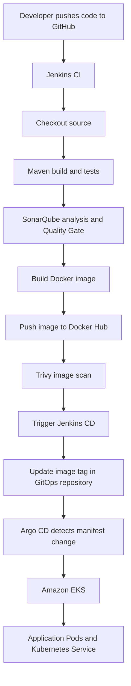

# Register App — CI/CD with Jenkins, Docker, SonarQube, Trivy, Argo CD and Amazon EKS

A hands-on DevOps project that demonstrates how application changes can move from a GitHub repository through a CI pipeline and into a Kubernetes cluster using a GitOps deployment workflow.

> **Project status:** Learning/demo project. Adapt credentials, network access, IAM permissions, resource sizes, and security settings before using this design in production.

## Overview

The project separates application source code from Kubernetes deployment configuration:

- **Application repository:** [register-app](https://github.com/antarctic672/register-app)
- **Container image:** [`antarctic672/register-app-pipeline`](https://hub.docker.com/r/antarctic672/register-app-pipeline)
- **GitOps repository:** [gitops-register-app](https://github.com/antarctic672/gitops-register-app)

When a change is pushed to the application's `main` branch, Jenkins checks out the code and runs the CI pipeline. If the pipeline succeeds, Jenkins builds and publishes a Docker image, scans it with Trivy, and triggers the CD pipeline. The CD pipeline updates the image tag in the GitOps repository. Argo CD detects the changed Kubernetes manifest and synchronizes the desired state to Amazon EKS.

## Architecture



## Technology stack

| Technology | Purpose |
|---|---|
| GitHub | Stores application source code and GitOps manifests |
| Jenkins | Automates CI and CD pipelines |
| Jenkins Agent | Runs pipeline builds and related commands |
| Java and Maven | Build and test the application |
| SonarQube | Static code analysis and Quality Gate |
| Docker | Packages the application into a container image |
| Docker Hub | Stores published container images |
| Trivy | Scans container images for vulnerabilities |
| AWS EKS | Runs the Kubernetes workloads |
| `kubectl` / `eksctl` | Interact with and provision Kubernetes/EKS resources |
| Argo CD | Reconciles Kubernetes resources from the GitOps repository |

## Repositories and key files

### Application repository

The application source repository is:

`https://github.com/antarctic672/register-app`

Important files typically include:

- `Jenkinsfile` — defines the CI pipeline.
- `pom.xml` — Maven project configuration and dependencies.
- Application source files — the code packaged and deployed by the pipeline.
- `Dockerfile` — defines how the application container image is built, if included in this repository.

Check the repository for the exact file names and layout.

### GitOps repository

The separate GitOps repository stores the desired Kubernetes configuration. The files described in the project setup include:

- `deployment.yaml` — declares the application Deployment, replica count, and container image/tag.
- `service.yaml` — defines how the application is exposed inside or outside the cluster, depending on its Service type.
- `Jenkinsfile` — defines the CD pipeline that updates the deployment image tag and pushes the manifest change to GitHub.

Keep the application source and deployment configuration separate so that the deployed version is visible in Git history.

## CI pipeline: `register-app-ci`

The CI job is configured in Jenkins to use the application repository and its `main` branch.

The pipeline stages are:

1. **Cleanup workspace** — removes files left by a previous build.
2. **Checkout from SCM** — retrieves the application source from GitHub.
3. **Build application** — runs `mvn clean package`.
4. **Test application** — runs `mvn test`.
5. **SonarQube analysis** — submits the code for static analysis.
6. **Quality Gate** — waits for the SonarQube Quality Gate result and can stop the pipeline if the gate fails.
7. **Build and push Docker image** — builds the container image and pushes versioned and `latest` tags to Docker Hub.
8. **Trivy scan** — scans the image for HIGH and CRITICAL vulnerabilities.
9. **Cleanup artifacts** — removes the local image created for the build, where configured.
10. **Trigger CD pipeline** — starts `gitops-register-app-cd` after the preceding stages succeed.

### Image naming

The image repository used by this project is:

```text
antarctic672/register-app-pipeline
```

The version tag is formed from the configured release and Jenkins build number, for example:

```text
1.0.0-60
```

The pipeline also publishes a `latest` tag. For repeatable deployments, prefer the specific version tag in Kubernetes manifests rather than relying on `latest`.

> **Security note:** If Trivy is configured with `--exit-code 0`, findings are reported but do not fail the build. Configure an appropriate non-zero exit code and remediation policy if vulnerabilities should block releases.

## CD pipeline: `gitops-register-app-cd`

The CD job receives the image tag from the CI job and uses the GitOps repository.

At a high level, it:

1. Checks out the GitOps repository.
2. Updates the container image reference in `deployment.yaml` to the image built by CI.
3. Commits and pushes the manifest change to the GitOps repository.
4. Allows Argo CD to detect and synchronize the updated desired state to EKS.

The exact trigger mechanism depends on the Jenkins job configuration. Configure the remote-build authentication token or Jenkins API-token authentication consistently; do not assume they are interchangeable.

## GitOps deployment flow

Argo CD watches the GitOps repository. When the image tag in the Kubernetes manifest changes, Argo CD compares the repository's desired state with the cluster state and synchronizes the resources according to the application's sync policy.

The Deployment manifest in this project is configured for **two replicas** in the example setup. Kubernetes schedules Pods onto available worker capacity; two replicas do **not** necessarily mean two separate EC2 instances.

The Kubernetes Service provides access to the Pods. If it is configured as a `LoadBalancer`, AWS can provision a load balancer and external DNS name. The actual access method depends on the committed Service manifest and AWS configuration.

## Prerequisites

Before reproducing the project, prepare:

- An AWS account with permission to create and manage the required EC2, IAM, EKS, networking, and load-balancing resources.
- A Jenkins controller and a connected Jenkins agent.
- A GitHub account and access to both repositories.
- A SonarQube server reachable from Jenkins.
- A Docker Hub account and repository.
- An EKS cluster and a machine or environment configured with AWS CLI, `kubectl`, and `eksctl` as needed.
- Argo CD installed and configured to access the GitOps repository and target cluster.
- Required Jenkins plugins, tools, credentials, and job configuration.

Use compatible versions of Java, Maven, Jenkins plugins, AWS CLI, `kubectl`, `eksctl`, and Argo CD for your environment. Exact versions are not specified here.

## How to test the pipeline

1. Make a small, safe change to the application code.
2. Commit and push it to the `main` branch of the application repository.
3. Confirm that `register-app-ci` starts.
4. Check the build, test, SonarQube Quality Gate, Docker push, and Trivy scan results.
5. Confirm that the CI job triggers `gitops-register-app-cd` and passes the expected image tag.
6. Check the GitOps repository to verify that `deployment.yaml` contains the new image tag.
7. Check Argo CD to confirm that the application is synchronized and healthy.
8. Verify the Kubernetes resources and test the application through the Service's configured endpoint.

## Challenges encountered

### Jenkins CI-to-CD trigger returned `403 Access Denied`

While configuring the CI pipeline to start `gitops-register-app-cd`, the request returned a `403 Access Denied` response with an invalid-token message. This highlighted an important distinction: Jenkins API-token authentication and a job's remote-build trigger token are different mechanisms. The trigger configuration and the authentication method used by the request must match.

### Keeping Jenkins credentials consistent

The pipelines rely on Jenkins credentials for services such as GitHub, SonarQube, Docker Hub, and Jenkins job triggering. The credential IDs referenced in a Jenkinsfile must match the IDs configured in Jenkins. This project keeps those credentials in Jenkins rather than storing secret values in the repository.

## Security and cost considerations

This project is intended for learning and should be hardened before production use.

- Avoid granting broad administrator permissions to EC2 roles. Apply least privilege.
- Restrict Jenkins, SonarQube, and Argo CD access to trusted users and networks; use HTTPS and strong authentication.
- Keep secrets in a credential manager rather than source control.
- Restrict inbound security-group rules to the necessary sources and ports.
- Pin production deployments to immutable image tags or digests, and establish a vulnerability policy for Trivy.
- Review Jenkins plugin updates and secure the Jenkins controller.
- Review EKS node sizes, replica counts, load balancers, public IPs, and persistent resources to control AWS costs.
- Delete lab infrastructure and unused load balancers when finished.

## Learning outcomes

By completing this project, you can practice:

- Building a Jenkins pipeline for a Java/Maven application.
- Running automated tests and static code analysis.
- Creating, scanning, and publishing Docker images.
- Passing an image version from CI to CD.
- Updating Kubernetes manifests through Git.
- Using Argo CD to deploy Git-managed configuration to Amazon EKS.

## Acknowledgment

This project was developed as a hands-on learning exercise based on a CI/CD walkthrough using Jenkins, Maven, Docker, SonarQube, Trivy, Argo CD, and Amazon EKS. Some initial files like the webapp were copied.

---

**Maintainer:** [antarctic672](https://github.com/antarctic672)
